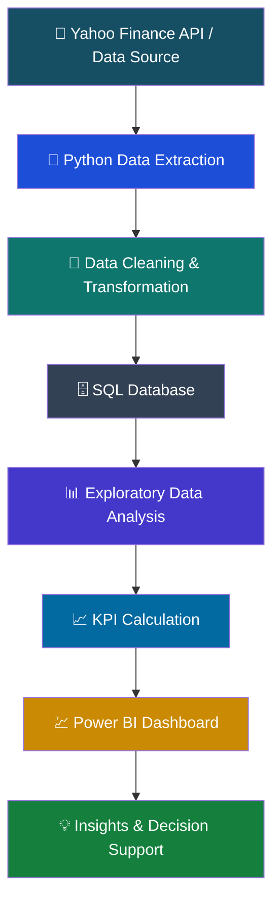

# 📈 Stock Market Analytics & Investment Decision Support Dashboard

  

  
  
  

  <b>Transforming historical stock market data into meaningful financial insights through data analysis, SQL, Python, and interactive Power BI dashboards.</b>

---

## 🌟 Overview

The **Stock Market Analytics & Investment Decision Support Dashboard** is a data analytics project developed as part of the Digital Egypt Pioneers Initiative (DEPI) – Professional Data Analysis Track.

The project aims to collect, process, analyze, and visualize stock market data to help users understand historical market performance, compare companies, monitor trading activity, and evaluate historical price volatility.

By combining Python, SQL, and Power BI, the project is planned to transform raw financial data into structured information and interactive visual insights.

## 🎯 Project Objectives

- 📥 Collect daily stock market data from Yahoo Finance.
- 🧹 Clean, transform, and validate financial datasets.
- 🗄️ Organize structured data using SQL.
- 📊 Perform Exploratory Data Analysis (EDA).
- 📈 Calculate financial and statistical KPIs.
- ⚖️ Compare historical performance across selected companies.
- 💡 Develop interactive Power BI dashboards.
- 🔍 Support informed investment analysis through transparent historical indicators.

## 🏗️ Proposed Data Workflow

The planned workflow follows a structured data analytics pipeline:

*Note: This represents the proposed architecture, not a completed implementation.*

## 🛠️ Technology Stack

  

| Technology | Purpose |
|---|---|
| Python | Data extraction, preparation, and analysis |
| SQL | Structured storage, querying, and data management |
| Power BI | Interactive dashboards and data visualization |
| Yahoo Finance | Financial market data source |
| Git & GitHub | Version control and team collaboration |

## 📊 Key Performance Indicators (KPIs)

The dashboard is planned to include the following financial indicators:

| KPI | Description | Calculation |
|---|---|---|
| Opening Price | Starting daily stock price | Open |
| Closing Price | Ending daily stock price | Close |
| Daily Return | Daily percentage price change | ((Current Close / Previous Close) - 1) × 100 |
| Daily Price Range | Intraday price difference | High - Low |
| Trading Volume | Number of shares traded | Volume |
| Average Trading Volume | Average daily trading activity | Average(Volume) |
| Historical Volatility | Variation in historical daily returns | Standard Deviation(Returns) |
| Period Return | Performance over a selected period | ((Last Close / First Close) - 1) × 100 |

## 📅 Project Roadmap

| Phase | Task | Schedule |
|---|---|---|
| 01 | Project Scope & Planning | Oct 13 – Oct 16 |
| 02 | Data Collection & Inspection | Oct 17 – Oct 21 |
| 03 | Data Cleaning & Transformation | Oct 22 – Oct 28 |
| 04 | Exploratory Data Analysis & KPIs | Oct 29 – Nov 5 |
| 05 | Data Modeling & Dashboard Development | Nov 6 – Nov 15 |
| 06 | Validation & Testing | Nov 16 – Nov 21 |
| 07 | Documentation & Presentation | Nov 22 – Nov 29 |
| 08 | Final Submission | Nov 30, 2026 |

## 👥 Team Members

This project is developed collaboratively by a team of six DEPI trainees.

| Team Member | Role |
|---|---|
| أحمد عبدالحميد محمد الجندي | SQL Developer |
| أحمد عبدالباسط مصطفى | Python Developer |
| رقية محمد عبدالسلام شلبي | Python Developer |
| زينب عبدالمنعم دياب | SQL Developer & GitHub Manager |
| بيشوي سامي يوسف بقطر | Power BI Developer |
| محمد إبراهيم عبدالله غنيم | Power BI Developer |

**Project Supervisor:** ENG. Adel Youssef

## 📚 Project Documentation

The following documents cover the first phase of the project:

| Document | Description |
|---|---|
| 📄 Literature Review | Research background, data sources, and project implications |
| 📄 Project Planning & Management | Project proposal, timeline, responsibilities, risks, and KPIs |
| 📄 Requirements Gathering | Project requirements and scope documentation |

📂 All documentation is available in the `documetation/` directory.

## 🔍 Research & Data Source

**Primary Data Source:** [Yahoo Finance](https://finance.yahoo.com/)

The project intends to use historical daily stock market observations, including:

- Date
- Open
- High
- Low
- Close
- Volume
- Adjusted Close (when available)

Data availability, coverage, and refresh frequency will be verified during implementation.

## ⚠️ Important Disclaimer

This project is intended for educational and analytical purposes only.

Historical stock performance and volatility do not guarantee future returns. The dashboard is designed to support data-driven analysis, not provide guaranteed investment recommendations.

## 📌 Project Information

| Attribute | Details |
|---|---|
| Initiative | Digital Egypt Pioneers Initiative (DEPI) |
| Track | Professional Data Analysis |
| Project | Stock Market Analytics & Investment Decision Support Dashboard |
| Phase | Phase 1 – Planning & Research |
| Submission Date | October 16, 2026 |
| Final Deadline | November 30, 2026 |

---

  

  <b>📊 Turning Data Into Decisions | DEPI Professional Data Analysis</b>

